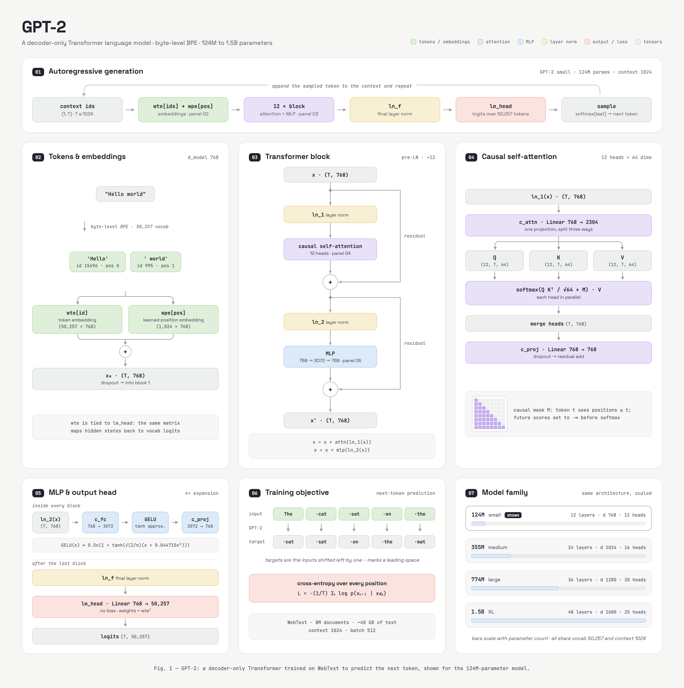

# gpt2-audit

Which parts of GPT-2 small does a kind of text selectively need, and can a cheap method predict it? Work in progress.



## Where it stands

The first step is a GPT-2 small forward pass written by hand, so every intermediate value is mine to inspect and change. `audit/model.py` rebuilds it with plain tensor operations on the pretrained Hugging Face weights:

| Stage | Function | Checked against | Tolerance |
|---|---|---|---|
| Token + position embedding | `embed` | `hidden_states[0]` | 1e-6 |
| LayerNorm | `layer_norm` | `h[0].ln_1` | 1e-6 |
| Causal self-attention, 12 heads | `attn` | `h[0].attn` | 1e-4 |
| MLP with tanh GELU | `mlp` | `h[0].mlp` | 1e-4 |
| Transformer block | `block` | `h[0]` | 1e-4 |
| Full model, 12 blocks + final LayerNorm + tied unembedding | `forward` | `GPT2LMHeadModel` logits on five prompts | 1e-4 |

Each stage has a test in `tests/`. The embedding test also checks that reversed positions do not match, so a passing test means the positions are right and not just ignored.

Next: use the forward pass to measure how much each head and MLP matters for different kinds of text.

## Run it

```sh
python3 -m venv venv
source venv/bin/activate
pip install -e ".[test]"
pytest
```

The first run downloads GPT-2 small (about 550 MB) from Hugging Face. `notebooks/gpt2.ipynb` lists every parameter and its shape.
